**Developer · Software · AI · Robotics**

I build and explore projects at the intersection of software, artificial intelligence, and hardware.

[GitHub](https://github.com/lnzindev) · [Repositories](https://github.com/lnzindev?tab=repositories) · [Activity](https://github.com/lnzindev?tab=overview)

---

## About

I'm **Luiz**, also known as **LNZINDEV**. I enjoy understanding how technology works under the hood and turning ideas into practical experiments. My interests include web development, AI integrations, 3D rendering, electronics, and robotics.

**Currently exploring:** JavaScript · Python · WebGL · ESP32 · Bluetooth LE · AI integrations

## Selected projects

| Project | Description |
| --- | --- |
| [**Rabbitech JARVIS**](https://github.com/lnzindev/Rabbitech-JARVIS) | Experimental AI assistant with web chat, browser voice features, and a procedural 3D lab. |
| [**Minecraft WebLab**](https://github.com/lnzindev/Minecraft-WebLab) | Experimental WebGL 2 renderer that interprets selected Minecraft Bedrock resource-pack assets. |
| [**ESP32 × LEGO Pybricks**](https://github.com/lnzindev/conexao-a-esp-com-lego-pybricks) | Bluetooth Low Energy experiments connecting ESP32 with LEGO hubs. |
| [**Rabbitech FLL Calculator**](https://github.com/lnzindev/Rabbitech-calculator-first-lego-league) | A project connected to FIRST LEGO League robotics. |

These projects are evolving experiments. Each repository documents its current scope, setup, and known limitations.

## Toolkit

## How I work

- **Build first:** learn by making prototypes and testing real ideas.
- **Understand the details:** investigate bugs instead of hiding them.
- **Iterate:** document limitations and improve projects step by step.

