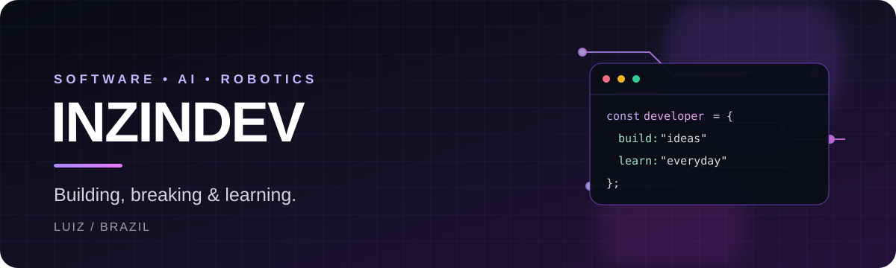

### Developer · Software · AI · Robotics

Building practical projects, exploring new technologies, and learning by creating.

---

## whoami

I'm **Luiz**, also known as **Inzindev**. I'm interested in software development and the connection between code, artificial intelligence, electronics, and robotics.

- 🔭 Working on **JARVIS** and **Minecraft WebLab**.
- 🧪 Learning through prototypes, experiments, debugging, and iteration.
- 🤖 Interested in robotics, embedded systems, automation, and game technology.
- 🌱 Currently exploring web development, Python, AI integrations, and 3D rendering.

## Featured work

### What I'm building

| Project | Focus |
| --- | --- |
| [Rabbitech JARVIS](https://github.com/lnzindev/Rabbitech-JARVIS) | Experimental AI assistant, browser voice features, and web interface. |
| [Minecraft WebLab](https://github.com/lnzindev/Minecraft-WebLab) | Experimental WebGL 2 renderer for selected Minecraft Bedrock assets. |
| [ESP32 + LEGO Pybricks](https://github.com/lnzindev/conexao-a-esp-com-lego-pybricks) | Bluetooth LE experiments between ESP32 and LEGO hubs. |
| [Rabbitech FLL Calculator](https://github.com/lnzindev/Rabbitech-calculator-first-lego-league) | Tooling connected to FIRST LEGO League robotics. |

Projects are works in progress. Check each repository for its current scope, setup, and limitations.

## Tech & tools

## Beyond the code

I enjoy robotics challenges, experimenting with hardware, and finding out how things work under the hood. I believe the best way to learn is to build something, test it, understand what failed, and make it better.

**Curiosity → Experiments → Better projects**

[Explore all repositories](https://github.com/lnzindev?tab=repositories) · [See my activity](https://github.com/lnzindev?tab=overview)

